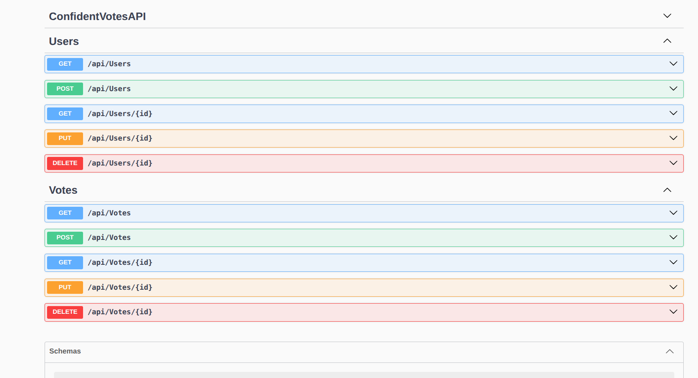

# REST API for elections management
## The API is aimed at management elections either for a small ones or in the future implementation for  nation-wide elections management. 

In this project, the following functionalities have been implemented:
  * Complete data base schema and integration with ASPNetCore EF and PostgreSql.
  * User Authentication and authorization implementation (Role-Based Access Control And Claim-Based Authorization).
  * Controllers for routing endpoints and CRUD operations for elections, options, voters and votes.
  * Custom middleware for headers.
  * GlobalValidator middleware for custom exception handling.
  * Swagger UI test using OpenAPI standard.

<!--  -->

## How to install and run ConfidentVoteAPI
 1. Install .NET 10 SDK
 2. Install PostgreSql and create login  

    ```bash
    dotnet user-secrets set "ConnectionStrings:PsqlDatabase" "Host=localhost;Port=your_db_port;Database=your_db;Username=yours;Password=your_password;"
    ```
 3. clone the repo with: <br>
    for https users: <br>

    ```bash
    git clone https://github.com/kafando2000/ConfidentVotesAPI.git
    ``` 
    <br>
    for ssh users: <br>

    ```bash
    git clone git@github.com:kafando2000/ConfidentVotesAPI.git
    ```
    
     <br>
 4. run the project: <br>
      If willing to generate an api client when running: <br>

      ```bash 
      dotnet watch run --generateapiclient true 
      ```
       <br>
      if not :

      ```bash 
      dotnet watch run
      ```
      <br>
       can use ConfidentVotesAPI.http file (locate at the root of the project folder) to test 

## Next Step
 1. Implement a clean client (User Interface) for Election creation and Management.
 2. Enhance Users Anonymity during votes by using encription for their special ID.
 3. Deploy deploy the client on Azure.