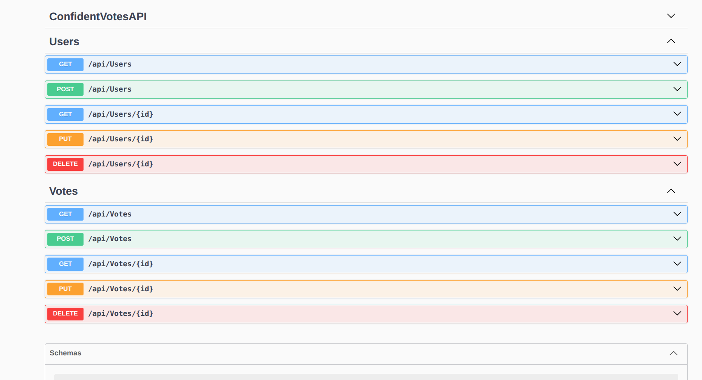

# REST API for votes
## A fully working REST API built with ASP.NET Core, integrating custom middleware for request validation and response duration tracking,   and tested with Swagger UI. It also generated an API client in C# using the NSwag library.

In this project, the following functionalities have been implemented:
  * Users service as Singleton to manage CRUD operations on user data
  * Votes service as Singleton to manage CRUD operations on vote data
  * Controllers for routing endpoints and CRUD operations for both Users and Votes
  * Custom exceptions for custom  headers in the request; for example, the "API-SIGNATURE" key was used
  * GlobalValidator middleware for custom exception handling
  * Swagger UI test using OpenAPI standard
  * Built-in authentication and authorization middleware
  * API client generation in C# code

## How to install and run ConfidentVoteAPI
 1. Install .NET 10 SDK
 2. clone the repo with : 
    https
    `git clone https://github.com/kafando2000/ConfidentVotesAPI.git`
    ssh
    `git clone git@github.com:kafando2000/ConfidentVotesAPI.git` 
 3. run the project :
    test with swagger UI (it bypass a custom validator for headers ):
      `dotnet watch run --testwithswaggerui true`
       head to http://localhost:5284/swagger/index.html to test
    test with the custom validator:
      `dotnet watch run --testwithswaggerui false`
       can use ConfidentVotesAPI.http file (locate at the root of the project folder) to test 

## Next
 For the moment the project is using session services to store data, 
 later on connection to real data base will be implemented
    
